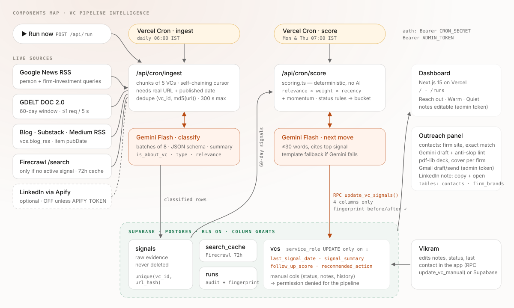
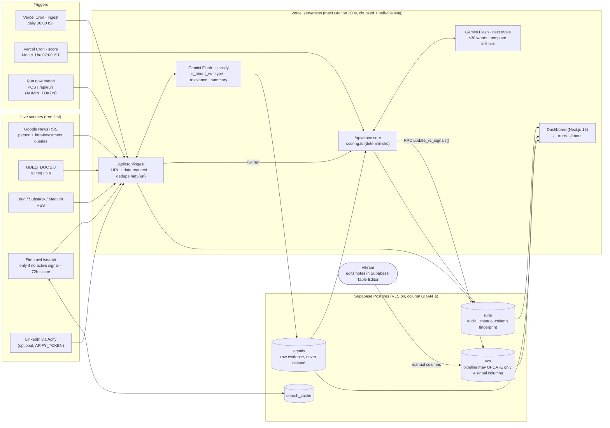

# Components Map

The rendered SVG above is also served live at `/components-map.svg` and embedded on `/about`.

## Components

| Component | Responsibility | Code |
|---|---|---|
| Vercel Cron | Triggers ingest daily and score twice a week (Hobby: ≤ 1/day per cron) | `vercel.json` |
| Ingest route | Pulls live evidence for 5 VCs per invocation, re-invokes itself with the next cursor | `src/app/api/cron/ingest`, `src/lib/chain.ts`, `src/lib/runs.ts` |
| Sources | Google News RSS, GDELT, blog RSS, Firecrawl (fallback), LinkedIn (optional) | `src/lib/sources/*` |
| Gemini Flash | Classifies evidence (entity check, type, relevance, summary) and drafts the next move | `src/lib/gemini.ts` |
| Scoring | Deterministic score, bucket and explanation | `src/lib/scoring.ts` |
| Score route | Scores each VC, writes the 4 signal columns via RPC | `src/app/api/cron/score`, `src/lib/pipeline.ts` |
| Supabase | `vcs`, `signals`, `runs`, `search_cache`; column GRANTs protect manual columns | `supabase/schema.sql` |
| Dashboard | Public read-only view of the ranking, evidence, run log and method | `src/app/*` |
